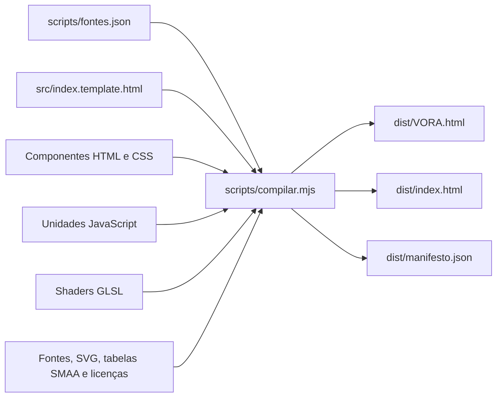

# Arquitetura do VORA

## Estratégia desta reorganização

O HTML recebido tinha um script clássico único com dependências de ordem, closures e estado compartilhado. A primeira reorganização separa responsabilidades físicas em arquivos, preservando o programa JavaScript e sua ordem. Não houve conversão para ES modules, engine diferente, framework ou nova física.

A revisão atual contém **88 unidades JavaScript**, 20 arquivos de shaders, cinco estilos, dez componentes de interface, fonte, símbolos SVG e duas tabelas SMAA. As unidades pequenas isolam contratos específicos, como resolução, persistência e matrizes. Elas **não** são scripts que se carregam mutuamente.

`scripts/fontes.json` declara a sequência. O gerador concatena tudo em **um único `<script>`**, sem wrappers por arquivo, minificação ou transformação de funções. As declarações continuam no mesmo escopo lexical. Isso evita duplicação de estado e conserva tanto o acesso entre sistemas quanto a execução direta em `file://`.

Não existe grafo de `import` em tempo de execução. As chamadas entre funções existentes podem ocorrer nos dois sentidos, como UI → melhoria → atualização da UI; essas relações foram preservadas. O grafo de montagem (template → componentes/recursos e manifesto → fontes) é acíclico e verificado. Esta etapa não transforma o código legado numa arquitetura de módulos isolados; essa evolução pode ocorrer depois, com contratos e testes próprios.

## Fluxo de geração

`gerar.cmd` encontra Node e executa `scripts/gerar.mjs`. O compilador resolve inclusões, embute os recursos, valida a sintaxe de cada unidade e do programa completo, verifica que não ficaram recursos externos e grava a distribuição. Só substitui o HTML anterior depois dessas validações. O manifesto registra tamanho, quantidade de fontes e hash do resultado. Não usa caminhos do arquivo original na geração.

Dentro de `scripts/compilar.mjs`, `expand()` resolve os marcadores, com funções próprias para recursos binários e JSON. `assembleScripts()` monta e valida o programa; `assembleStyles()` insere os estilos na ordem do manifesto; `validateHtml()` verifica o HTML completo. A API pública continua sendo `localPath`, `read`, `expand`, `assemble` e `build`, além de `ROOT` e `manifest`. Os nomes, mensagens de erro, ordem das validações e formato da saída são preservados.

`build()` grava o mesmo HTML em `dist/VORA.html` (uso offline pelo nome anterior) e `dist/index.html` (entrada do site), além de `dist/manifesto.json`. A montagem acontece uma vez; os dois HTMLs são idênticos e autossuficientes, com o hash comum registrado no manifesto. `tests/estrutura.test.mjs` verifica essa igualdade. `.gitattributes` preserva os bytes dos dois arquivos gerados.

O Pages publica a raiz de `main`. O `index.html` dessa raiz é uma entrada estática pequena que abre `./dist/index.html`; `.nojekyll` dispensa o processamento do Jekyll. Esses arquivos são mantidos como fontes da publicação, enquanto o jogo completo continua sendo gerado em `dist/`. O prefixo do repositório é preservado pelo endereço relativo. Consulte [GITHUB-PAGES.md](GITHUB-PAGES.md) para configurar e atualizar a publicação.

Marcadores suportados:

| Uso | Marcador na fonte | Saída |
| --- | --- | --- |
| HTML ou licença | `<!-- @include assets/icones.svg -->` | Conteúdo inline |
| Shader como string | `/* @text src/graficos/shaders/tela.vert */` | String JavaScript com escape automático |
| Shader interpolado | `/* @template src/graficos/shaders/cena.frag */` | Template literal, mantendo `${TERRAIN_FIELD_GLSL}` etc. |
| JSON com dados | `/* @json assets/smaa/lookup.json */` | Objeto JavaScript |
| Binário dentro do JSON | `"@base64 assets/smaa/area.rgba"` | Base64 dos bytes |
| Recurso em CSS | `url("@asset assets/fontes/vora-ui.woff")` | Data URI |

`{{STYLE_0}}`, `{{STYLE_1}}` e `{{SCRIPTS}}` são pontos de inserção do template principal. Nenhum desses marcadores aparece no arquivo final.

## Estado e inicialização

| Estado | Declaração canônica | Responsabilidade |
| --- | --- | --- |
| `state` | `src/jogo/salvamento.js` | Progresso e preferências serializados em `vora-v1` |
| `player`, `camera`, `keys`, `joy`, `objects` | `src/jogo/estado.js` | Estado transitório da partida |
| `cargoBodies` e velocidades | `src/fisica/carga.js` | Corpos atuais; poses salvas em `state.cargoPoses` |
| `spawnZones`, RNG, timers | `src/jogo/spawns.js` | Objetos e disponibilidade das áreas; snapshot em `state.spawnWorld` |
| `depotFlights`, reservas e meshes | `src/jogo/deposito.js` | Descarga transitória; estoque persistido em `state.depot` |
| `gl`, `WEBGL2` | `src/graficos/contexto.js` | Contexto WebGL 2, WebGL 1 ou fallback CPU |
| `lighting`, passes e alvos | `src/graficos/texturas.js`, `iluminacao.js`, `imagem.js` | Recursos gráficos transitórios |
| Estado dos menus e pickers | `src/interface/menus.js`, `layout.js`, `seletores.js` | Foco, posição e interação |

O manifesto preserva as seguintes fases do original:

1. Define fallback CPU e medidas; cria canvas/contexto e carrega o save.
2. Define estado, funções de jogo e UI; registra handlers que só usarão os sistemas após a inicialização.
3. Define física, mundo, modelos, vegetação, presets, spawns, entrada, administração e depósito.
4. Define shaders, cria programa de cena e configura recursos/passagens gráficas.
5. Define malhas, movimento visual do buraco, materiais, simulação, render e câmera.
6. Define layout e pickers; executa `src/jogo/iniciar.js`.

A sequência final é: migrar escala → preparar modelos → animações/controles → gerar mundo/carga → iluminação → resolução → HUD → distância/presets → menus/interior → persistir → solicitar o primeiro frame. O loop usa subpassos de até 1/60 s para atualizar a simulação. Alterar a ordem pode causar acesso a `const`/`let` antes da inicialização ou recursos ainda ausentes.

Essa sequência descreve a entrada histórica. Atualmente `iniciar.js` chama `startVora()`: o programa principal da GPU, o mundo, os modelos, a iluminação, os menus e a geometria são preparados por generators em fases. `completeVoraLoading()` libera a partida e a persistência somente depois do sucesso. O mapa atual das fases, fila e cache está em [CARREGAMENTO.md](CARREGAMENTO.md).

Os três fluxos centrais têm os seguintes pontos de entrada:

| Fluxo | Coordenação | Etapas |
| --- | --- | --- |
| Geração | `scripts/compilar.mjs`: `assemble()` e `build()` | Expandir fontes → montar JS/CSS → validar HTML → gravar distribuição e manifesto |
| Inicialização | `src/jogo/carregamento.js`: `initializeVoraSteps()` e `startVora()` | Consumir as fases na ordem declarada → concluir ou apresentar falha |
| Partida | `src/jogo/loop.js`: `frame()` | Conferir liberação/cadência → avançar simulação → apresentar cena → contar desenhos → agendar próximo quadro |

Na inicialização, `initializeVoraControls()` reúne a migração de escala e os controles; `restoreVoraInterface()` reúne a restauração dos ajustes e menus. Essas funções só executam quando sua fase é consumida. Pesos, retomadas dos generators, cancelamento e tratamento de falhas continuam no carregamento.

No loop, `advanceGameSimulation()` processa a fila de recursos, mantém a vegetação, observa a cadência, avança os subpassos e persiste quando necessário, nessa ordem. `drawGameFrame()` atualiza o interior e a inspeção mesmo quando a cena 3D é reutilizada, e informa se desenhou. `frame()` concentra o contador de FPS e o agendamento em um único ponto. O limite de FPS continua sendo verificado antes da simulação, como na implementação anterior.

A simplificação desses fluxos preserva a ordem do manifesto, o escopo compartilhado e o HTML único. `tests/fluxo.test.mjs` cobre os bloqueios do loop, os subpassos, a ordem da persistência, a reutilização da cena, o contador e a liberação de fases interrompidas; esses testes de coordenação não medem GPU ou layout.

`persist()` chama `saveCargoPhysics()`, `saveSpawnWorld()` e `saveWorldResourceSpawns()` antes de gravar o único `state`. Não mantenha outro objeto de save em paralelo. O snapshot dos recursos do cenário só é gravado após sua preparação completa.

## Onde encontrar cada sistema

A revisão atual tem 88 unidades JavaScript e cinco estilos. `jogo/progressao.js` centraliza os lotes medidos e as melhorias, `jogo/limite-fps.js` controla a cadência da cena, `interface/expansao.js` monta as melhorias e a superfície vazia de skill tree, e `interface/inspecao.js` controla a inspeção animada de objetos. O estilo adicional usa `{{STYLE_4}}`. O dossiê passou a agrupar portes e a reposição usa pontos fixos. Os formatos canônicos, migrações e contratos estão em [PROGRESSAO-E-PONTOS-FIXOS.md](PROGRESSAO-E-PONTOS-FIXOS.md); os números de distribuição das revisões abaixo são históricos.

A submissão de objetos e sombras agrupa malhas idênticas em `graficos/instancias.js`, com fallback individual. `jogo/indice-coleta.js` fornece a broad phase espacial preservando a ordem de coleta. Contratos, medições e limites estão em [PERFORMANCE-AVANCADA.md](PERFORMANCE-AVANCADA.md).

A revisão de custo da GPU usa programas opaco/profundidade em `graficos/visibilidade-gpu.js`, descarte pelo volume da luz e cache de apresentação em `graficos/cache-cena.js`. Medições diretas e contratos estão em [GPU-VISIBILIDADE-E-PROFUNDIDADE.md](GPU-VISIBILIDADE-E-PROFUNDIDADE.md). A filtragem das sombras Alta/Ultra usa um resumo conservador em `graficos/sombras-limites.js`, preparado durante o carregamento e mantido junto do mapa estático; pesquisa, custos e verificações estão em [GPU-SOMBRAS-CONSERVADORAS.md](GPU-SOMBRAS-CONSERVADORAS.md). A correção de silhuetas entre LODs, as sombras de calçadas/grama, o AO por horizontes e os materiais atuais estão em [REVISAO-LUZ-E-MATERIAIS.md](REVISAO-LUZ-E-MATERIAIS.md). `graficos/sombras-lod.js` participa da chave do mapa estático; `shaders/ao-superficie.glsl` é a reconstrução compartilhada e `shaders/superficies.glsl` contém o detalhe de materiais.

A inspeção por pressão usa uma máscara limitada a 512 × 512 amostras da malha em uso, sem alterar o objeto ou criar outro contexto WebGL. Câmera, parallax, anotações e contratos de projeção estão em [INSPECAO-DE-OBJETOS.md](INSPECAO-DE-OBJETOS.md).

O conteúdo de todos os cartões de melhoria vem de `interface/componentes/melhoria-card.html`, embutido por `@text` e montado em `createUnifiedUpgradeCard()`. Botões e campos existentes são preservados dentro desse componente comum. A régua visual mantém 20 traços para todos os limites de nível e é preenchida proporcionalmente.

Ao comprar raio, `upgrade('r')` preserva a distância pretendida da câmera ajustando o fator de zoom ao novo raio. Assim, o afastamento automático do enquadramento padrão não cancela o crescimento aparente da abertura nos níveis maiores. A interpolação de `cavityVisual`, a escala física e os níveis salvos permanecem os mesmos; zoom manual e reenquadramento por `resetCamera()` continuam disponíveis. `tests/crescimento-buraco.test.mjs` verifica a abertura projetada antes/depois da compra, com o jogador parado, em quatro faixas de nível, além de compra recusada e restauração do progresso.

A expansão de recursos consumíveis está em `src/jogo/recursos-mundo.js`; consulte [MUNDO-CONSUMIVEL.md](MUNDO-CONSUMIVEL.md). Essa unidade liga o cenário a proxies de coleta, guarda IDs e contagens de reposição no estado canônico e reutiliza os fluxos de carga e venda. `src/mundo/recursos-layout.js`, incluído imediatamente antes dela, define as regiões, a colocação incremental, a orientação conforme os caminhos e os novos modelos de apoio. A etapa inicial do dossiê tinha 78 unidades JavaScript e quatro estilos; a reorganização inicial tinha 75 unidades. As regras anteriores de desbloqueio e reposição estão em [DISTRIBUICAO-SPAWNS-E-SOMBRAS.md](DISTRIBUICAO-SPAWNS-E-SOMBRAS.md).

A carga de recursos preserva a malha do cenário até a descarga. `resourceCargoModel`/`resourceCargoShape` compartilham modelo, escala e dimensões com o corpo; `graficos/carga.js` e a vista interna usam essa representação. `cargoPoses[].resourceId` é opcional e validado contra os recursos gerados na restauração, preservando a leitura dos saves anteriores. A caixa continua representando os lotes portáteis. A física reativa corpos quando o relevo muda com o deslocamento e adapta o grid ao maior diâmetro de colisão.

`cargoRim` é um estado transitório derivado da física, sem campo novo no save. Uma pilha apoiada que ultrapassa o terreno na abertura por mais de 0,22 s aciona “Borda cheia” e impede novas coletas mesmo com litros livres. O teste usa as esferas compostas já existentes, com a pose atual e a altura local do terreno; objetos entrando/em queda não bloqueiam a abertura sozinhos. A margem de entrada é 3 cm e a de saída 1 cm; 0,18 s livres removem o bloqueio, evitando oscilações rápidas. A descarga vazia libera imediatamente; aumentar a profundidade libera quando a pilha realmente baixar. `cargoCanFit`, coleta direta, loop e dossiê respeitam o mesmo limite, separado do volume em litros. `tests/borda-cheia.test.mjs` cobre esses comportamentos em ambiente simulado.

O buraco visível usa 48 setores e 16 anéis em `graficos/malha-buraco.js`: 1.392 triângulos, contra 7.056 da malha anterior (redução de 80,3%). Parede e fundo usam iluminação por face; o shader reaproveita a normal geométrica já calculada e o fallback CPU calcula normais por triângulo em `shadeCavityFacets`. A GPU mantém vértices compartilhados, sem duplicá-los para o efeito facetado. Os pontos continuam amostrando `surfaceVertex`/o perfil analítico; raio, profundidade, coleta e colisões não mudam. O teste específico em `desempenho-avancado.test.mjs` substitui a antiga exigência de igualdade de todos os vértices por redução de triângulos, fidelidade das amostras e preservação do fundo físico em quatro faixas de tamanho. Redução de geometria não constitui medição de FPS.

O dossiê em Carga é definido por `src/interface/dossie.js`, `componentes/dossie.html` e `estilos/dossie.css`. A unidade fica antes de `layout.js`; seus controles são vinculados em `initUIRedesign()` durante o boot. O componente é incluído pelo template e o estilo é acrescentado após os estilos existentes via `{{STYLE_3}}`. A consulta usa referências aos recursos e as malhas de produção, sem alterar o save. A prévia usa uma instância privada de `SoftwareGL`, com atualização sob demanda e sem criar outro contexto WebGL. Leia [DOSSIE-E-INTERIOR.md](DOSSIE-E-INTERIOR.md).

| Sistema | Fontes principais / funções úteis |
| --- | --- |
| HTML principal | `src/index.template.html` |
| HUD e canvas | `src/interface/componentes/hud.html`, `hud.js`, `feedback.js` |
| Menus, páginas e foco | `src/interface/menus.js`, `layout.js`, `seletores.js`, `componentes/*.html` |
| Tema, dimensões, hover e contornos | `src/interface/estilos/base.css`, `tema.css` (ordem preservada) |
| Animações | `src/interface/animacoes.js`; `motionAllowed`, `playUI`, `animateMenuOpen` |
| Corte isométrico e X-ray | `src/interface/interior.js`; `setInsideMode`, `buildInsideSection`, `drawInsideCargo`, `drawInside` |
| Escala dos menus 40–160% | `src/interface/layout.js`; `interfaceScale`, `applyMenuFrame`, `setInterfaceScale` |
| Qualidades e Personalizada | `src/interface/qualidade.js`; `GRAPHICS_PRESETS`, `applyGraphicsPreset` |
| ADM, dinheiro infinito, inspeção | `src/interface/administracao.js`, `spawns.js`; `toggleAdminMode`, `toggleSpawnInspector` |
| Save, validação, defaults | `src/jogo/salvamento.js`, `persistencia.js`, `nova-partida.js` |
| Medidas e migração geométrica | `src/jogo/medidas.js`, `migracao-escala.js`, `tipos.js` |
| Teclado e joystick | `src/jogo/teclado.js`, `joystick.js`; `initGameInput`, `clearGameInput` |
| Mouse, câmera e gestos | `src/jogo/camera.js`; `orbitCamera`, `zoomCamera`, `panCamera`, `touchGesture` |
| Movimento, coleta e capacidade | `src/jogo/movimento.js`, `coleta.js`, `simulacao.js` |
| Melhorias, preços e missões | `src/jogo/melhorias.js`, `estado.js`, `spawns.js` |
| Áreas, distribuição e reaparecimento | `src/jogo/spawns.js`; `SPAWN_CATALOG`, `makeSpawnSlots`, `tickSpawns` |
| Inventário, descarga, venda e caixa | `src/interface/inventario.js`, `src/jogo/deposito.js`; `unloadDepot`, `sellDepot`, `upgradeDepot` |
| Partida e loop | `src/jogo/geracao.js`, `loop.js`, `iniciar.js` |
| Colisões, queda e carga no buraco | `src/fisica/carga.js`; `solveImpulse`, `terrainBodyContact`, `solveCargoPairs`, `stepCargoPhysics` |
| Contato com a base e apoios | `src/fisica/base.js`, `apoio.js` |
| Parque ampliado | `src/mundo/parque-ampliado.js`; `populateOuterVegetation`, `populateParkTrees`, `extendParkLayout` |
| Terreno e caminhos | `src/mundo/terreno.js`, `caminhos.js`; `terrainElevationAt`, `walkFieldAt`, `buildWalkMesh` |
| Árvores, objetos e folhas | `src/mundo/modelos.js`, `folhas.js`; `ModelBuilder`, `getModelMesh`, `foliageLeaf` |
| Vegetação e LOD | `src/mundo/vegetacao.js`, `vegetacao-render.js`; `buildParkLayout`, `buildGroundDetails`, `drawGroundDetails` |
| Base e modelo da caixa | `src/mundo/base.js`, `deposito-modelo.js` |
| Forma do buraco | `src/mundo/buraco.js`, `ruido.js`; `apertureRadius`, `sampleBasin`, `wallSection`, `cavityHeightAt` |
| Materiais compartilhados CPU/interior | `src/mundo/materiais.js` |
| GPU e fallback | `src/graficos/contexto.js`, `compatibilidade.js`, `programa.js` |
| Render e malhas | `src/graficos/cena.js`, `malhas.js`, `malha-buraco.js`, `carga.js` |
| Iluminação e sombras | `src/graficos/iluminacao.js`, `texturas.js`, `sombras.js`, `sombra-contato.js` |
| Resolução, FSR e AA | `src/graficos/resolucao.js`, `imagem.js`, `multiamostragem.js`, `smaa.js`, `temporal.js` |
| Oclusão ambiente | `src/graficos/oclusao.js`, `shaders/ao-*.glsl`, `shaders/composicao.frag` |
| Composição, adaptação e medição GPU | `src/graficos/composicao.js`, `temporizacao.js` |
| Shader principal e materiais GPU | `src/graficos/shaders/cena.*`, `terreno-*.glsl`; registros em `shaders-cena.js`, `shaders-terreno.js` |
| Fonte e ícones | `assets/fontes/vora-ui.woff`, `assets/icones.svg` |

`docs/ORIGEM.json` é um mapa de procedência da extração, não um mapa de linhas do HTML gerado. Para localizar uma função, procure nas fontes; para investigar erros, consulte também a unidade no manifesto.

A revisão visual da área de vendas e das placas está descrita em [MODELOS-VENDAS-E-PLACAS.md](MODELOS-VENDAS-E-PLACAS.md). Em `buildStationMeshes`, os detalhes de precisão usam unidades finais e são incorporados ao lote sólido após a conversão das peças estruturais por `stationHeight`.

A paleta atual e o quiosque de vendas estão descritos em [PALETA-E-AREA-DE-VENDAS.md](PALETA-E-AREA-DE-VENDAS.md). Alterações de cor das árvores e plantas preservam posições, normais e tags de acabamento; cores procedurais do terreno têm versões correspondentes em `terreno.js` e `terreno-albedo.glsl`.

A calçada é recortada sob a fundação permanente da loja no shader e no fallback CPU (`walkSurfaceVisibleAt`). Isso evita superfícies coplanares disputando profundidade ao afastar a câmera. Os detalhes finos do piso em `mundo/base.js` também têm alturas separadas da base e da plataforma; fundação e apoios físicos mantêm suas medidas. `stationCoversWalkway()` reúne a condição dos passes de cor e sombra sem antecipar o descarte em relação às derivadas. No modelo da loja, `weighbridgeEdgeY` e `floorDetailY` nomeiam as alturas compartilhadas antes da conversão por `stationHeight`. `tests/piso-loja.test.mjs` cobre o interior, a borda, o chanfro e a tolerância vertical do recorte.

## Imagem e compatibilidade

O pipeline mantém resolução de saída, reconstrução FSR espacial e AA independentes. Permanecem os oito modos de reconstrução, 14 perfis de AA, quatro níveis de AO e cinco distâncias de visão presentes na referência. MSAA, SMAA, TAA e alvos de alta resolução continuam dependendo das extensões e limites da GPU, com as alternativas existentes.

Sombras agora têm cinco perfis independentes, registrados em `state.shadowQuality`: `off`, `low`, `balanced`, `high` e `ultra`. O seletor fica em Imagem, junto da distância de visão, fora dos ajustes avançados. Saves sem essa preferência recebem `high`, que conserva as resoluções históricas; uma escolha válida é preservada. Reinício da partida e presets gráficos também incluem a preferência. As trocas de mapas passam pela fila progressiva de recursos e mantêm os alvos anteriores até os novos estarem prontos.

`state.shadowDistance` controla separadamente seis alcances em torno do alvo da câmera: `very_low`, `low`, `medium`, `high`, `very_high` e `ultra`. O shader suaviza a sombra entre 82% e 100% do alcance. A extensão do mapa e o descarte dos emissores acompanham esse alcance, com margem para a câmera se mover antes da recentralização do cache. A assinatura dos presets passou de seis para sete campos; assinaturas antigas válidas são estendidas sem reaplicar o preset sobre escolhas individuais.

A oclusão ambiente usa SSAO de contato orientado pela normal, mantendo as chaves `off`, `fast`, `balanced` e `high`. O nome histórico `ao-horizonte.glsl` e os nomes das strings/uniforms continuam válidos, mas o shader deixou de integrar horizontes. Alcance, espessura finita, bias e uma redução gradual de efeitos menores que poucos pixels limitam falsos contatos. Filtro e reconstrução bilateral conferem normais e os planos das duas superfícies. O escurecimento máximo é 42% da contribuição ambiente; luz direta e névoa não recebem essa atenuação. Os perfis e a validação em GPU estão em [SOMBRAS-E-OCLUSAO.md](SOMBRAS-E-OCLUSAO.md).

FSR neste jogo usa EASU/RCAS e os modos espaciais documentados na própria interface; não foi convertido em FSR temporal. O fallback `SoftwareGL` renderiza a mesma geometria por CPU e limita resolução/cadência conforme o original.

### Névoa e trabalho evitado

`src/graficos/shaders/nevoa.glsl` define os limites/cor compartilhados entre cena e AO. O shader de composição atenua somente a contribuição ambiente da superfície, preservando a luz da névoa. Os shaders de AO e filtro devolvem visibilidade neutra quando a névoa já é opaca. A cena mantém a escrita de profundidade, mas evita materiais e sombras nesses fragmentos. Com AO desligado, o passe de FXAA não precisa ler profundidade/normais.

O índice `spawnObstacles` em `src/jogo/spawns.js` é um cache de obstáculos estáticos, com células de 128 unidades. Ele consulta candidatos locais e conserva os testes exatos de distância. A geração atual adiciona obstáculos ao fim dos arrays e substitui os arrays ao regenerar o mundo; ambos os casos são detectados. **Se uma alteração futura mover/remover/mudar o raio de um obstáculo dentro do mesmo array, chame `invalidateSpawnObstacles()`** antes de consultar slots. O índice não é parte do save.

`buildGroundDetails()` calcula os tiles sem criar templates detalhados de áreas invisíveis. `bakePlantTile()` reutiliza um buffer de triângulo e uma área contígua em precisão dupla antes da conversão final para Float32. `buildWalkMesh()` reutiliza as amostras já existentes da malha compartilhada. O solver dispensa o grid de colisões entre objetos quando há somente um corpo, mantendo os contatos com o terreno/base.

Os contratos de geometria, física e distribuição são comparados com o original. As mudanças autorizadas à paridade textual estão listadas em `tests/contratos.mjs`. Detalhes e medições: `docs/NEVOA-E-DESEMPENHO.md`.

## Oportunidades para outra etapa

As otimizações de preparação foram integradas sobre a refatoração do PR #2. O cache privado em `mundo/caminhos.js` reaproveita coordenadas exatas sem mudar a geometria; `jogo/carregamento.js` preserva os helpers refatorados, o prazo de 5 ms e a espera da GPU, com teto de 1.024 retomadas. `verificar.cmd --arquivo nome.test.mjs` permite verificações dirigidas, mantendo todos os testes por padrão. Estratégia e limites: [CARREGAMENTO-E-TEMPO-DE-RESPOSTA.md](CARREGAMENTO-E-TEMPO-DE-RESPOSTA.md).

Medir FPS e memória num navegador real com save/câmera fixos. Investigar separadamente custo de sombras estáticas/dinâmicas, descarte de tiles de vegetação, rebuild da malha do buraco durante movimento e renderização do interior com muita carga. O código já possui batching, cache, culling, LOD, sleeping e timers; confirme o gargalo antes de alterar essas estratégias. As otimizações já implementadas e seus limites estão no registro específico acima.
